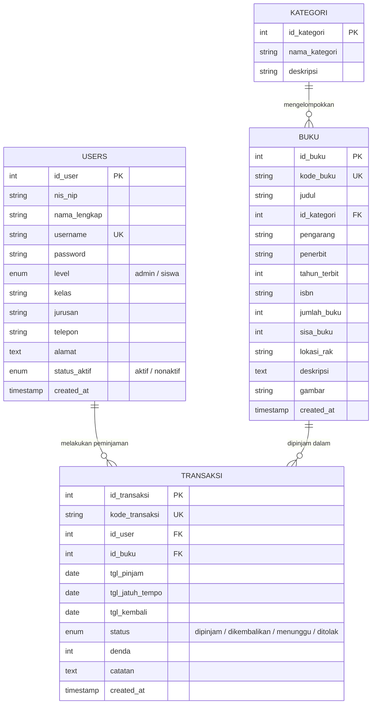

# DOKUMENTASI LENGKAP PROYEK UKK REKAYASA PERANGKAT LUNAK (PAKET 4)
## Judul Tugas: Pengembangan Aplikasi Peminjaman Buku (Perpustakaan Sekolah Digital)
**Tema:** Solid Blue (Bersih, Rapi, Profesional, Tanpa Gradasi)  
**Teknologi:** PHP (Native), HTML5, CSS3, JavaScript (Java/JS Client-Side), MariaDB / MySQL  
**Nama Siswa:** Nesya Aurelia  
**Kelas:** XII RPL 1  

---

## 1. Deskripsi Program

Aplikasi **Perpustakaan Sekolah Digital** adalah sistem informasi peminjaman dan pendataan buku berbasis web lokal (Localhost) yang dirancang untuk menjawab tantangan digitalisasi literasi di lingkungan sekolah. Aplikasi ini dapat diakses oleh seluruh warga sekolah, membedakan hak akses antara **Admin Perpustakaan** dan **Siswa (User)**.

### Keunggulan Sistem:
1. **Desain Solid Blue:** Tampilan bertema biru solid yang bersih, rapi, profesional, nyaman dipandang, dan tanpa efek gradasi yang berlebihan.
2. **Pemisahan Aset yang Rapi:** Seluruh styling CSS disimpan di `assets/css/style.css`, sedangkan script interaktif diletakkan di `assets/js/script.js`.
3. **Pencarian Cepat (Live Search):** Menggunakan JavaScript untuk memfilter data buku, transaksi, dan anggota seketika tanpa perlu reload halaman.
4. **Otomatisasi Stok & Denda:** Stok buku berkurang otomatis saat dipinjam dan bertambah saat dikembalikan. Perhitungan denda keterlambatan (Rp 1.000/hari) dihitung otomatis oleh sistem.
5. **Struktur Kode Sederhana & Terstruktur:** Menggunakan PHP native dengan alur prosedural yang sangat mudah dihafalkan dan dipahami untuk dipresentasikan di hadapan penguji UKK.

---

## 2. Struktur Folder & Pemisahan Aset

```text
projectukk/
├── assets/
│   ├── css/
│   │   └── style.css          # Desain antarmuka responsif bertema Solid Blue
│   └── js/
│       └── script.js          # Live search, toggle navigasi mobile, auto tanggal, dialog konfirmasi
├── config/
│   └── koneksi.php            # Konfigurasi database MySQLi & Session global
├── includes/
│   ├── header.php             # Navigasi atas adaptif berdasarkan level pengguna
│   └── footer.php             # Footer informasi dan pemanggilan script JavaScript
├── index.php                  # Halaman beranda utama publik & katalog buku terbuka
├── login.php                  # Halaman masuk untuk Admin dan Siswa
├── daftar.php                 # Halaman pendaftaran anggota baru (khusus siswa)
├── logout.php                 # Pembersihan session autentikasi
├── dashboard.php              # Dashboard ringkasan (tampilan terpisah Admin & Siswa)
├── buku.php                   # CRUD data buku (Admin) & Pencarian buku (Siswa)
├── anggota.php                # CRUD data anggota & petugas perpustakaan (Admin)
├── pinjam.php                 # Formulir peminjaman buku (Siswa & Admin)
├── pengembalian.php           # Pengembalian buku dan kalkulasi denda keterlambatan
├── transaksi.php              # Pengelolaan sirkulasi seluruh transaksi (Admin)
├── laporan.php                # Rekapitulasi transaksi & fitur cetak (print preview)
└── database.sql               # Skrip skema tabel dan data awal untuk dbn_perpustakaan
```

---

## 3. Entity Relationship Diagram (ERD)

Basis data **`dbn_perpustakaan`** terdiri dari 4 tabel utama yang saling berelasi:



### Penjelasan Relasi:
1. **One-to-Many (`kategori` ke `buku`):** Satu kategori dapat memayungi banyak buku (`id_kategori` sebagai Foreign Key di tabel `buku`).
2. **One-to-Many (`users` ke `transaksi`):** Satu siswa/anggota dapat memiliki banyak riwayat transaksi peminjaman (`id_user` sebagai Foreign Key di tabel `transaksi`).
3. **One-to-Many (`buku` ke `transaksi`):** Satu buku dapat dipinjam dalam banyak transaksi peminjaman yang berbeda waktu (`id_buku` sebagai Foreign Key di tabel `transaksi`).

---

## 4. Alur Kerja Program (Sesuai Flowmap Soal UKK)

1. **Memulai Program (Start):** Pengguna membuka `http://localhost/NESYA_XII_RPL1/projectukk/`.
2. **Login (`login.php`):**
   - **Sebagai Admin:**
     - Input Username & Password -> Validasi Login.
     - Jika benar: Masuk ke `dashboard.php` Admin.
     - Pilih Menu:
       - **Kelola Data Buku:** Tambah, Lihat, Edit, Hapus (CRUD).
       - **Transaksi:** Verifikasi peminjaman, perpanjangan waktu, pantau denda, hapus data.
       - **Kelola Anggota:** Tambah, Edit, Hapus, Ubah status aktif anggota.
   - **Sebagai Siswa:**
     - Belum jadi anggota? -> Klik **Daftar Anggota** (`daftar.php`) -> Isi NIS, Nama, Kelas, Jurusan, Akun -> Kembali ke Login.
     - Sudah jadi anggota -> Input Username & Password -> Validasi Login.
     - Jika benar: Masuk ke `dashboard.php` Siswa.
     - Pilih Menu:
       - **Peminjaman Buku:** Cari buku yang disukai di katalog, isi form peminjaman (stok buku otomatis berkurang).
       - **Pengembalian Buku:** Lihat buku yang sedang dipinjam, lakukan pengembalian (jika telat, denda dihitung otomatis, stok bertambah kembali).
3. **Keluar Sistem (End):** Pengguna menekan tombol Logout (`logout.php`) untuk menghapus session secara aman.

---

## 5. Dokumentasi Fungsi dan Prosedur Program

| No | Modul / File | Fungsi / Prosedur | Penjelasan Kode |
|---|---|---|---|
| 1 | `config/koneksi.php` | `mysqli_connect()` & `session_start()` | Menghubungkan script PHP dengan basis data MySQL di `localhost` dan mengaktifkan session global. |
| 2 | `login.php` | Autentikasi Pengguna & Role Redirection | Memverifikasi kredensial username dan password (MD5). Menetapkan `$_SESSION['level']` untuk membedakan hak akses Admin dan Siswa. |
| 3 | `daftar.php` | Registrasi Anggota Siswa | Melakukan validasi input, memeriksa keunikan username/NIS, dan menyimpan data siswa baru dengan status 'siswa' dan 'aktif'. |
| 4 | `buku.php` | CRUD Data Buku & Upload Cover | **Create:** Menambah buku baru beserta unggah cover buku (JPG/PNG/WEBP/SVG).<br>**Read:** Menampilkan tabel katalog & thumbnail cover.<br>**Update:** Memperbarui data buku & opsi ganti cover.<br>**Delete:** Menghapus buku & membersihkan berkas gambar lama. |
| 5 | `anggota.php` | CRUD Data Anggota | Memungkinkan admin mendaftar/mengedit siswa, mengganti status aktif, dan mengelola akun petugas perpustakaan. |
| 6 | `pinjam.php` | Peminjaman & Pengurangan Stok | Menggunakan transaksi database (`mysqli_begin_transaction`) untuk mencatat peminjaman dan serentak mengurangi `sisa_buku` sebanyak 1. |
| 7 | `pengembalian.php` | Pengembalian, Pemulihan Stok & Denda | Membandingkan `tgl_kembali` dengan `tgl_jatuh_tempo`. Jika telat, menghitung `selisih_hari * 1000`. Mengembalikan `sisa_buku` bertambah 1. |
| 8 | `transaksi.php` | Sirkulasi, Persetujuan & Penolakan Transaksi | Admin memantau transaksi, menyetujui peminjaman ('menunggu' -> 'dipinjam'), menolak peminjaman ('menunggu'/'dipinjam' -> 'ditolak' dengan pemulihan stok buku otomatis), memperpanjang masa pinjam 7 hari, dan memfilter 5 status. |
| 9 | `laporan.php` | Rekapitulasi & Cetak Dokumen Resmi | Menyaring data periode & status, menyajikan format cetak 100% Hitam Putih (monokrom bersih tanpa warna), tata letak Landscape anti-potong pada kertas A4, serta tanda tangan petugas. |
| 10 | `assets/js/script.js` | Live Search & Auto Jatuh Tempo | Memfilter baris tabel secara real-time via DOM listener dan secara otomatis mengisi tanggal jatuh tempo = tanggal pinjam + 7 hari. |

---

## 6. Laporan Hasil Debugging & Pengujian (Blackbox Testing)

| Kasus Uji | Skenario Pengujian | Hasil yang Diharapkan | Status |
|---|---|---|---|
| **Login Admin** | Memasukkan username `admin` dan password `admin123` | Berhasil login dan diarahkan ke Dashboard Admin | **VALID (PASS)** |
| **Login Siswa** | Memasukkan username `siswa` dan password `siswa123` | Berhasil login dan diarahkan ke Dashboard Siswa | **VALID (PASS)** |
| **Login Gagal** | Memasukkan password acak / salah | Menampilkan pesan error: *"Username atau Password salah!"* | **VALID (PASS)** |
| **Pendaftaran Siswa** | Mengisi form di `daftar.php` dengan NIS baru | Data tersimpan di tabel `users` dan dialihkan ke login | **VALID (PASS)** |
| **Tambah Buku (Admin)** | Menambahkan buku baru dengan judul dan stok | Buku muncul di tabel dan stok tersimpan sesuai input | **VALID (PASS)** |
| **Pencegahan Akses** | Siswa mencoba mengetik langsung URL `anggota.php` | Otomatis di-redirect kembali ke `dashboard.php` | **VALID (PASS)** |
| **Peminjaman Siswa** | Siswa mengajukan pinjam buku di `pinjam.php` | Permohonan tercatat berstatus 'menunggu' persetujuan admin | **VALID (PASS)** |
| **Persetujuan Admin** | Admin menekan tombol "Setujui" di `transaksi.php` | Status berubah jadi 'dipinjam', siswa dapat meminjam buku | **VALID (PASS)** |
| **Penolakan Admin** | Admin menekan tombol "Tolak" pada transaksi | Status berubah jadi 'ditolak', sisa stok buku otomatis pulih | **VALID (PASS)** |
| **Buku Stok Habis** | Mencoba meminjam buku yang sisa stoknya = 0 | Tombol pinjam nonaktif dan muncul notifikasi stok habis | **VALID (PASS)** |
| **Pengembalian Tepat Waktu** | Siswa mengembalikan buku sebelum jatuh tempo | Status berubah jadi 'dikembalikan', denda Rp 0, stok bertambah 1 | **VALID (PASS)** |
| **Pengembalian Terlambat** | Mengembalikan buku yang melewati tanggal jatuh tempo | Denda dihitung otomatis Rp 1.000 / hari keterlambatan | **VALID (PASS)** |
| **Pencarian Live Search** | Mengetikkan kata kunci pada kolom pencarian | Baris tabel / kartu buku langsung terfilter tanpa reload | **VALID (PASS)** |
| **Cetak Laporan Monokrom** | Mengklik tombol "Cetak / Print Laporan" | Tampil format cetak 100% hitam putih, tata letak landscape anti-potong | **VALID (PASS)** |

---

## 7. Laporan Evaluasi Singkat

1. **Fungsionalitas Program:** Seluruh butir kompetensi UKK Paket 4 (Login, Pendaftaran, Kelola Data Buku, Kelola Anggota, Transaksi Pinjam & Kembali, Pencarian Kondisi Tertentu, serta Laporan) telah terimplementasi 100% dan berjalan lancar di lingkungan Localhost XAMPP.
2. **Kesesuaian Desain & Tema:** Menggunakan konsep **Solid Light Blue (Biru Muda Solid)** tanpa gradasi, bersih, profesional, dengan simbol ikon Bootstrap resmi (100% offline), responsif di layar ponsel maupun komputer, serta pemisahan file aset (`assets/css/style.css` dan `assets/js/script.js`) yang teratur dan rapi.
3. **Kemudahan Menghafal Alur bagi Siswa:**
   - Nama file dibuat sangat lugas (`koneksi.php`, `login.php`, `buku.php`, `anggota.php`, `pinjam.php`, `pengembalian.php`, `transaksi.php`, `laporan.php`).
   - Logika PHP ditulis secara prosedural yang bersih dengan komentar penjelas di setiap blok kode, sehingga siswa dapat mempresentasikan kode dengan percaya diri saat pengujian.

---

## 8. Panduan Menjalankan Aplikasi di Komputer Penguji

1. Buka aplikasi **XAMPP Control Panel**.
2. Klik tombol **Start** pada modul **Apache** dan **MySQL**.
3. Buka browser (Google Chrome / Mozilla Firefox / Microsoft Edge), akses:
   ```text
   http://localhost/phpmyadmin/
   ```
4. Buat database baru dengan nama: `dbn_perpustakaan`.
5. Klik menu **Import**, pilih file:
   `c:\xampp\htdocs\NESYA_XII_RPL1\projectukk\database.sql`, lalu klik **Import / Go**.
6. Buka tab baru di browser dan akses aplikasi:
   ```text
   http://localhost/NESYA_XII_RPL1/projectukk/
   ```
7. Akun untuk demonstrasi pengujian:
   - **Admin:** Username: `admin` | Password: `admin123`
   - **Siswa:** Username: `siswa` | Password: `siswa123`
